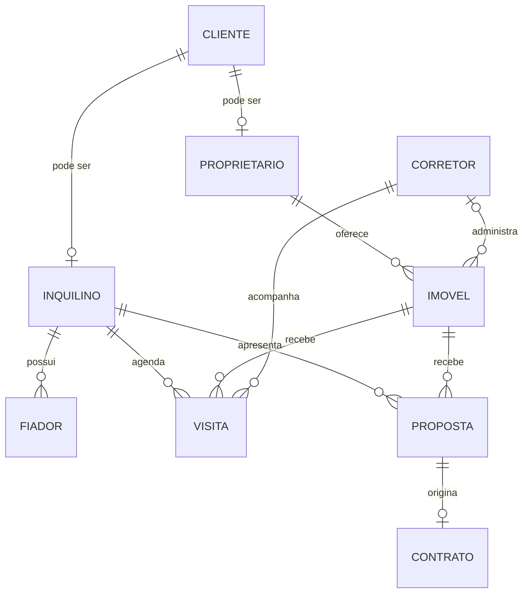

# Modelo de dados

O modelo separa os dados comuns de `cliente` dos papéis de `proprietario` e `inquilino`. Uma proposta relaciona um inquilino a um imóvel; o contrato é criado somente depois da aceitação dessa proposta.

## Regras garantidas

- CPF e CRECI são únicos.
- A validade de uma proposta não pode anteceder sua criação.
- Um contrato exige ao menos dois fiadores para o inquilino.
- Uma proposta vencida não pode originar contrato.
- Um imóvel não pode ter dois contratos ativos no modelo atual.
- A inserção e a remoção de contrato atualizam automaticamente a situação do imóvel.
- O corretor de uma visita é sempre o responsável cadastrado para o imóvel.

> [!NOTE]
> O modelo trata todos os contratos como ativos. Para um sistema de produção, seria adequado acrescentar vigência, encerramento e histórico de reajustes.
